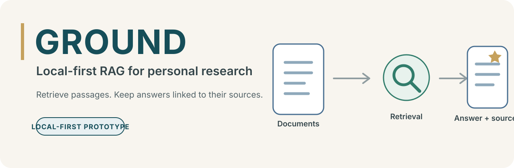
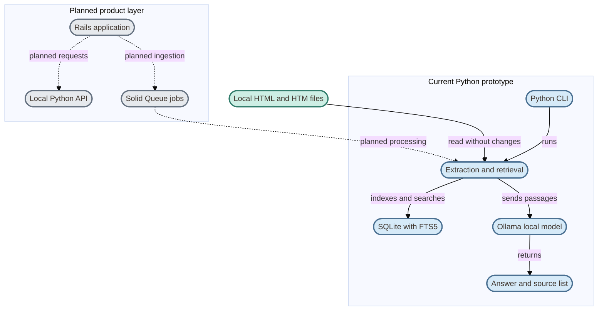

  

# Project GROUND

**Local-first RAG for personal document collections.**

GROUND explores how to make a local document library searchable and generate answers connected to the passages and files they came from.

## Contents

- [Overview](#overview)
- [Prototype today](#prototype-today)
- [Conceptual architecture](#conceptual-architecture)
- [Design principles](#design-principles)
- [Scope and next steps](#scope-and-next-steps)
- [References](#references)

## Overview

GROUND is an experimental retrieval-augmented generation (RAG) project for personal research. It ingests documents, retrieves relevant passages, and can send that context to a locally running language model to produce an answer with a source list.

The first prototype works with HTML and HTM documents. The project explores a local-first workflow that may later expand to PDFs and other formats, with a Rails product interface around a Python document and retrieval core.

> **Prototype status**
>
> The current prototype uses lexical search with SQLite FTS5 and local generation through Ollama. It is an active learning project, not a production-ready service.

This repository is the public project overview. The prototype's source code and reproducible setup instructions are not published here yet.

## Prototype today

| Available in the prototype | Planned next |
| --- | --- |
| Read HTML and HTM files in place; leave originals unchanged. | Add and compare local semantic embeddings and hybrid retrieval. |
| Extract text by headings, split it into passages, and store metadata in SQLite FTS5. | Evaluate retrieval and answer grounding with a representative question set. |
| Search passages lexically and return their title, section, and source path. | Build a Rails product interface and a local Python API boundary. |
| Send retrieved passages to Ollama and return an answer with a source list. | Add resumable ingestion jobs with Solid Queue; choose a vector backend from measurements. |

## Conceptual architecture

The solid arrows show the current prototype. Dashed arrows show planned product components and integrations.

## Design principles

- **Local first:** keep source documents, indexes, and model calls on the user's machine by default.
- **Traceable answers:** return source locations so readers can inspect the material behind an answer.
- **Non-destructive ingestion:** read originals in place and keep the index separate and rebuildable.
- **Incremental work:** skip unchanged files and refresh the index when sources change.
- **Measured evolution:** compare retrieval methods and evaluate answers before adding complexity.

## Scope and next steps

The prototype has not yet been validated against a representative personal collection. The first milestone is to assess HTML extraction, lexical retrieval, and source grounding, then record failures and limitations.

Semantic embeddings, vector retrieval, answer-quality evaluation, the Rails interface, the local API, and background ingestion are planned work. The vector backend remains open until the collection and retrieval needs have been measured. The current design does not require LangGraph, CrewAI, or another agent framework.

## References

- [Project Ground board](https://github.com/orgs/ezoatworks/projects/8/views/1?system_template=kanban)
- [SQLite FTS5](https://www.sqlite.org/fts5.html)
- [Ollama API](https://github.com/ollama/ollama/blob/main/docs/api.md)
- [Ruby on Rails Guides](https://guides.rubyonrails.org/)
- [Solid Queue](https://github.com/rails/solid_queue)
- [Project portfolio](https://enogrob.github.io/projects/)

---

**Project GROUND — Answers connected to their sources.**
