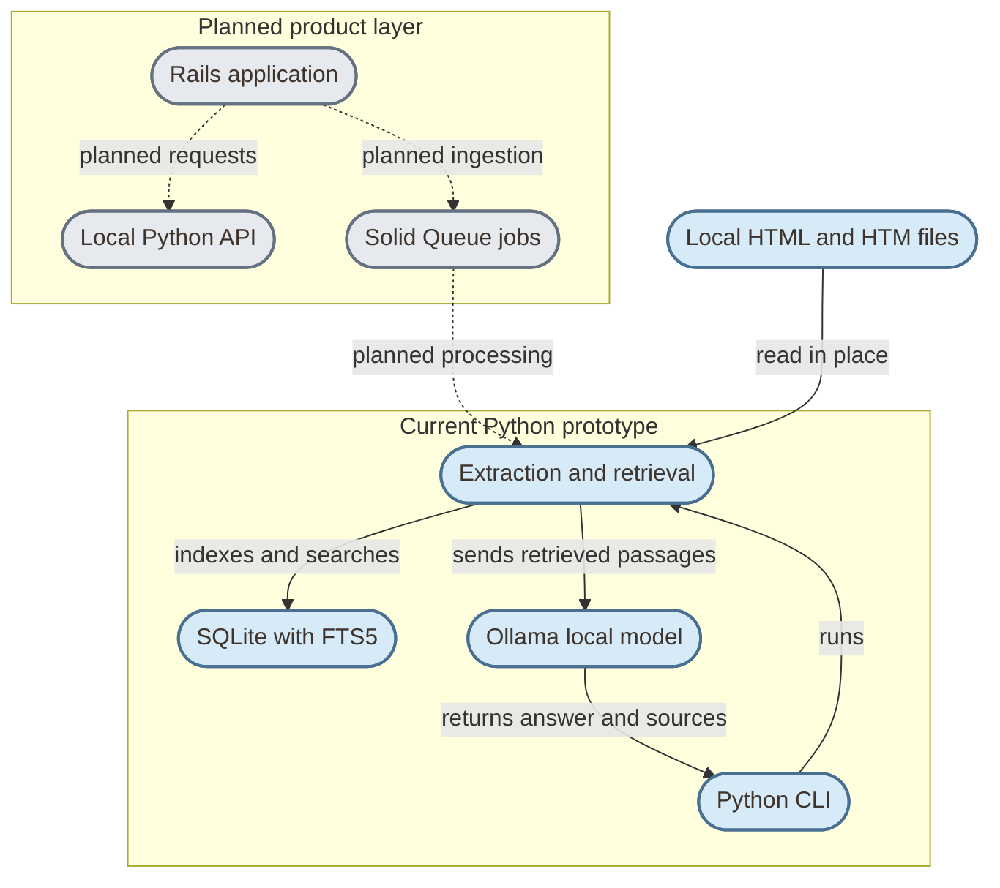

# Project GROUND

**Local-first RAG for personal document collections.**

GROUND explores how to make a local document library searchable and how to generate answers that remain connected to the passages and files they came from.

## Contents

- [Overview](#overview)
- [Conceptual architecture](#conceptual-architecture)
- [Current prototype](#current-prototype)
- [Design principles](#design-principles)
- [Scope and status](#scope-and-status)
- [References](#references)

## Overview

GROUND is an experimental retrieval-augmented generation (RAG) project for personal research. It ingests documents, retrieves relevant passages, and can send that context to a locally running language model to produce an answer with a source list.

The project begins with HTML and HTM documents. It is designed to explore a local-first workflow that can later expand to PDFs and other formats, with a Rails product interface around a Python document and retrieval core.

This repository is the public project overview. Implementation details and reproducible run instructions will be published here as they are prepared for public release.

## Conceptual architecture

The solid arrows show the implemented prototype flow. Dashed arrows show planned product components; they are not implemented yet.

## Current prototype

The Python command-line prototype can:

- Read HTML and HTM files recursively without changing the originals.
- Extract text around headings and split it into passages.
- Store document metadata and passages in SQLite with FTS5.
- Search passages lexically and show their title, section, and source path.
- Skip unchanged files and refresh the index when a source file changes.
- Send retrieved passages to a local Ollama chat model and return an answer with its source list.

Retrieval currently uses lexical keyword search. Semantic embeddings, vector retrieval, formal answer-quality evaluation, the Rails interface, and the Rails-to-Python API are future work.

The prototype's source code and local setup instructions are not included in this public overview yet.

## Design principles

- **Local first:** keep source documents, indexes, and model calls on the user's machine by default.
- **Traceable answers:** return the source passages used so a reader can inspect the underlying material.
- **Non-destructive ingestion:** read originals in place and keep the index separate and rebuildable.
- **Incremental work:** avoid reprocessing unchanged files and refresh changed documents.
- **Measured evolution:** compare retrieval approaches and evaluate answer quality before adding complexity.
- **Clear system boundaries:** keep the product interface separate from document processing and retrieval.

## Scope and status

GROUND is an active prototype and learning project, not a production-ready service. The first milestone is to validate HTML ingestion and lexical retrieval on a representative collection, then assess source grounding and answer quality.

The next planned steps are local semantic embeddings, retrieval comparison, and a Rails product layer with a local API boundary. Solid Queue is planned for resumable ingestion once Rails manages that work. The vector backend remains an open decision.

The project does not currently depend on LangGraph, CrewAI, or another agent framework. It starts with a direct retrieval-and-answer flow so that the retrieval quality and source traceability can be understood first.

## References

- [Project Ground board](https://github.com/orgs/ezoatworks/projects/8/views/1?system_template=kanban)
- [SQLite FTS5](https://www.sqlite.org/fts5.html)
- [Ollama API](https://github.com/ollama/ollama/blob/main/docs/api.md)
- [Ruby on Rails Guides](https://guides.rubyonrails.org/)
- [Solid Queue](https://github.com/rails/solid_queue)

---

**Project GROUND — Answers connected to their sources.**
